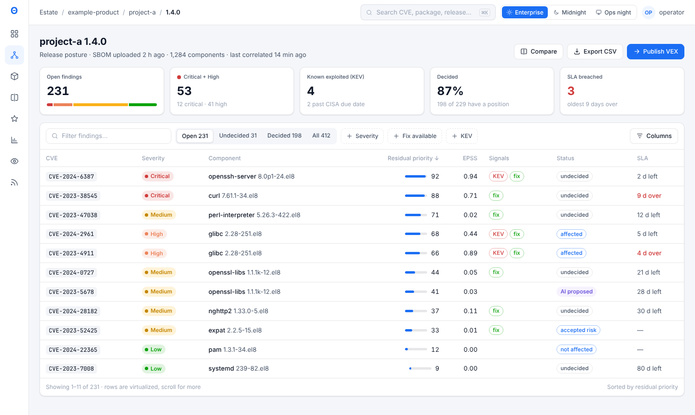
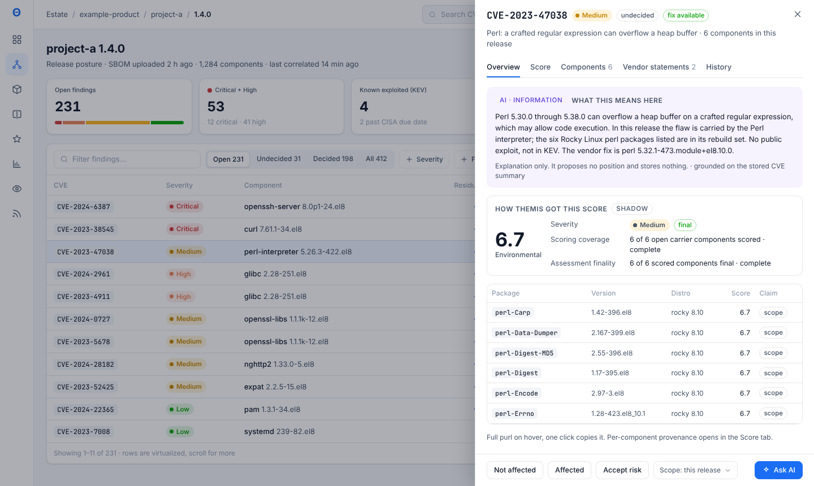
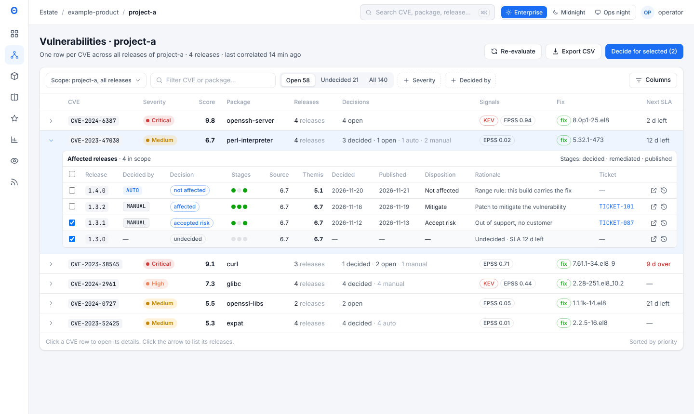

# EDR-GUI-02 — The dashboard front end on React, shadcn/ui and Tailwind CSS

Status: **PROPOSED — 2026-11-22.** Owner asked for the stack (React + shadcn/ui + Tailwind CSS)
and the three shades (Enterprise, Midnight, Ops night) on 2026-11-22 and gave the go for this
design record. Every build step in section "Steps" waits for its own go.
Date: 2026-11-22
Author: the "new React GUI" planning discussion of 2026-11-22.

## Purpose

Engineering Decision Record for **rebuilding the browser half of the dashboard** on React,
shadcn/ui and Tailwind CSS. The server half (`cmd/dashboard`, `internal/dashboard/*`) stays: sign-in,
sessions, the `/api/<node>` proxy, scope enforcement and identity checks are EDR-GUI-01 decisions
and this record does not reopen them.

This record **supersedes EDR-GUI-01 D7's JS syntax gate and narrows D8** (assets are now a build
output, still embedded). Everything else in EDR-GUI-01 stands, including D5 (the GUI adds no
private endpoints) and D6 (the AI honesty contract).

It also closes the BACKLOG T1 item "record the GUI's vanilla-JS-no-framework choice": that choice is
now recorded, and reversed, here with its alternatives.

## Where we are (measured 2026-11-22, main `cd76cae`)

- One hand-written file, `cmd/dashboard/static/app.js`: **3,160 lines, 206 KB raw, 60 KB gzipped**,
  no libraries, every screen in it (overview, estate, release posture, finding drawer, scan, SBOM
  manager, compare, what's new, CVE page, reports, watches, feeds, admin).
- Screens are built as HTML strings: **114 `innerHTML` assignments**, each relying on a hand call
  to `esc()` for every value. One missed call is an XSS hole, and nothing checks for it.
- Two themes over one token contract in `style.css` (21 KB): Enterprise (light) and Midnight
  (dark). Status and band colours are fixed across themes.
- No compiler and no component tests; the only gate is `make js-check` (`node --check`, syntax only).
- Hash routing (`#/release/<id>?v=…`, `#/cve/<id>`, …). Communication's webhook serializer builds
  `<dashboard>/#/release/<id>` links, so those route shapes are a contract with messages already
  sent to people.

The old choice was right for a spike and a first release: one binary, no supply chain, no Node.
It is now the main cost of every GUI change: shared parts (tables, chips, drawers, panels) are
copied, not reused, and each new screen adds to the one file.

## Decisions

### D1 — Stack: React + TypeScript + Tailwind CSS + shadcn/ui

- **React** (current major, exact version pinned in `package-lock.json`) with **TypeScript in
  strict mode**.
- **Tailwind CSS** (v4) for all styling. The theme tokens (D7) are CSS variables that Tailwind
  reads, so a component never names a colour value.
- **shadcn/ui** for components: dialog, sheet (the finding drawer), dropdown menu, tabs, select,
  command/combobox, tooltip, toast, table, badge, button, input. shadcn/ui is **copied source** in
  our tree (on Radix primitives), not a runtime package we cannot read, so we own and review every
  line of it.
- **lucide-react** for icons (tree-shaken; only icons used are shipped).
- **TanStack Query** for API state (D5), **TanStack Table** for tables (shadcn/ui's data table is
  built on it) and **TanStack Virtual** for long lists (D6).

Alternatives considered: keep vanilla JS (fastest first paint, but the cost above keeps growing);
Vue or Svelte (fine tools, but the owner asked for React and shadcn/ui is React-only); htmx with
server templates (would move rendering into the Go binary and grow it into a second view layer).

### D2 — Format: a Vite single-page app, not Next.js

The GUI is a **static single-page app built with Vite**. The output is plain files (one
`index.html`, hashed JS and CSS chunks) served by the dashboard binary as today.

| Option | Runs as | Keeps one Go binary | Why not |
| --- | --- | --- | --- |
| **Vite SPA (chosen)** | static files, `go:embed` | yes | — |
| Next.js (server) | a Node.js process beside the dashboard | no | server rendering brings nothing behind a login; adds a second runtime, a second auth path and a second systemd unit |
| Next.js static export | static files | yes | the same output as Vite with most Next features switched off and a slower build |
| Keep vanilla JS | as today | yes | see "Where we are" |

### D3 — The built files are committed; `go build` needs no Node

`npm run build` writes into `cmd/dashboard/static/`, and **the built output is committed**.
`go:embed` and `go build ./...` stay unchanged, so the VM build
(`go build -o bin/ ./cmd/...`) and every Go-only developer keep working with no Node installed.

CI proves the committed output matches the source: `make web-verify` runs a clean `npm ci` +
build and fails on any difference (`git diff --exit-code cmd/dashboard/static`). Node is pinned
(`web/dashboard/.nvmrc` and `engines`) so the build is byte-stable across machines.

Alternatives considered: build in the Makefile only (every VM and Go-only machine then needs Node
to build the dashboard); a separate release artifact (a second thing to version and deploy).

### D4 — Routing keeps today's hash routes

The router uses **hash routes with the same shapes as today** (`#/`, `#/estate`,
`#/release/<id>?v=…`, `#/scan/<id>?rel=…`, `#/cve/<id>`, `#/compare`, `#/new`, `#/reports`,
`#/watches`, `#/feeds`, `#/sbom`, `#/admin`). Links already sent by the webhook, Teams and mail
routes keep working, and the Go server needs no history-API fallback.

### D5 — Data: TanStack Query over the existing proxy, types from the OpenAPI specs

- Every call goes through the same-origin proxy `/api/<node>/…`. One small fetch module keeps
  today's meanings: `401` → go to `/login`; `502` → "node unreachable" panel naming the node;
  `404` → empty; `204` → no body; a non-2xx answer the caller reads (scope preview, AI reasons)
  stays readable.
- **TanStack Query** caches answers by key: one request when several parts of a screen need the
  same data, instant back-navigation, background refresh. The cache lives in memory only; nothing
  is written to browser storage except the theme choice (EDR-GUI-01 D1: the GUI holds no truth).
- **TypeScript types are generated from `api/*.openapi.yaml`** (`openapi-typescript`, types only,
  no generated client runtime). A node that renames a field breaks the GUI build, not the screen.
- The AI reason and detail stay **two headers** read separately (`X-Themis-AI-Reason`,
  `X-Themis-AI-Detail`), never joined (CLAUDE.md, fixed 2026-09-22).

### D6 — Tables: TanStack Table, virtual rows for long lists

All tables use one shared data-table component (sort, filter, column visibility). A table that can
pass about 200 rows (findings, components, matches, watch rows) renders through TanStack Virtual,
so only the visible rows are in the page. Where an endpoint can return thousands of rows, paging
on the server (`limit` / cursor) is a read-API change in the owning context first (EDR-GUI-01 D5).

### D7 — Three shades, fixed status colours

The owner chose three shades on 2026-11-22:

| Shade | Kind | Note |
| --- | --- | --- |
| **Enterprise** | light, **default** | today's light theme, same tokens |
| **Midnight** | dark | today's dark theme, same tokens |
| **Ops night** | darker | dim green-grey for long sessions and dark rooms: page `#101412`, card `#161b18`, ink `#c9d3cc`, secondary ink `#7f8c84`, accent `#3fa37a` |

- Each shade is one block of CSS variables on `:root[data-theme="<name>"]`; Tailwind and every
  shadcn/ui component read only those variables.
- **Status and band colours are fixed across all shades** (critical `#d03b3b`, serious `#ec835a`,
  warning `#fab219`, good `#0ca30c`), as in EDR-GUI-01. Severity always carries a text label
  beside the colour.
- The top-bar toggle becomes a three-option picker. The choice is kept in `localStorage` under
  the existing key `themis-theme`; an unknown or retired name falls back to `enterprise`. The
  theme is applied before first paint (a few lines in `index.html`), so a dark user never sees a
  light flash.
- Text contrast meets WCAG AA in every shade (checked in the skeleton step by an automated test).

### D8 — Performance rules

1. **Split by screen.** Each route is a lazy chunk; the first load carries the shell and the
   screen opened.
2. **Size budget.** First-load JS **≤ 150 KB gzipped** (today 60 KB with no libraries). CI fails
   past it, so the GUI cannot grow heavy unnoticed.
3. **Cache headers.** The dashboard serves hashed files under `/assets/` with
   `Cache-Control: public, max-age=31536000, immutable`, and `index.html` with `no-cache`: a new
   release is picked up on the next load and nothing is downloaded twice.
4. **Pre-compressed files.** The build writes `.br` and `.gz` copies; the dashboard sends the
   smallest the browser accepts. No compression work per request.
5. **Cached API answers** (D5) and **virtual rows** (D6).

Rules 3 and 4 are a small change to `assetHandler` in `cmd/dashboard/main.go`, inside the
dashboard binary; no node changes.

### D9 — Security

- The server-side model is unchanged: keys never reach the browser, the session cookie is
  HttpOnly + SameSite=Strict (+ Secure over TLS), scope and identity checks stay at the proxy
  (EDR-GUI-01 D3, D4, D11–D13).
- **No raw HTML**: `dangerouslySetInnerHTML` is forbidden by a lint rule. React escapes every
  value, which removes the 114 hand-escaped sites as a class of bug.
- The dashboard sends a **Content-Security-Policy**: `default-src 'self'; script-src 'self';
  style-src 'self'; img-src 'self' data:; connect-src 'self'; frame-ancestors 'none'`. The Vite
  build emits no inline script; the one inline theme line (D7) is moved to a file or covered by a
  hash. If a shadcn/ui part needs injected `<style>` elements, `style-src` gains
  `'unsafe-inline'` and nothing else; G1 measures which and records it here.
- **Supply chain**: `package-lock.json` committed, `npm ci --ignore-scripts` everywhere (no
  install scripts run), exact versions, a short dependency list kept in STACK.md. A new npm
  dependency needs the owner's approval, the same rule as a new Go module. `npm audit` runs in CI
  and fails on a high or critical advisory in a runtime dependency.

### D10 — Tests and gates

- **Vitest + Testing Library** for components and the fetch module (401/502/404/204 handling,
  AI reason headers, theme fallback).
- **Playwright** for the main flows against the dashboard binary with stub nodes: sign in,
  estate → release → drawer, accept a proposal, switch shade.
- `make web-check` = ESLint + `tsc --noEmit` + Vitest with coverage (≥ 80% lines on
  `web/dashboard/src`) + size budget. `make check` and `make check-ci` gain `web-check` and
  `web-verify`; the PR and main workflows gain a pinned `setup-node` step.
- `make js-check` stays while the old `app.js` ships and is removed with it.

### D11 — Move over screen by screen, old GUI stays until the new one is complete

1. The new app is served at **`/next/`** beside the old GUI (both embedded). Same sign-in, same
   session, same proxy.
2. Screens are ported one PR at a time, each with a VM check. Bug fixes continue in the old GUI;
   new GUI features land only on a ported screen.
3. When every screen passes, `/` serves the new GUI and the old one moves to `/classic/` for one
   release.
4. Then the old `app.js`, `style.css` and `make js-check` are deleted.

**Owner amendment 2026-11-23 (order change).** After trying G1 on the VM, the owner asked to make
the new GUI the default **now**, before G2-G5, with the old GUI at **`/old/`** (not `/classic/`).
So step 3 happens early:

- `/` serves the new GUI's page; its files keep their `/next/` URLs (the build's base), and
  `/next/` itself redirects to `/`. The old GUI is served at `/old/` with the prefix stripped.
- Any hash route the new GUI has not rebuilt yet is handed to `/old/#/<route>`. That keeps the
  links already sent by the webhook, Teams and mail routes (`/#/release/<id>`, `/#/reports`)
  working: they reach the new GUI, which forwards them. The rail marks those screens "opens the
  old GUI", and the top bar has an "Old GUI" link.
- Sign-in returns to the page asked for when that page is under `/old/` (or `/next/`), instead of
  always to `/` — the defect that made `/next/` look like the old GUI on the first VM try.
- Steps 2 and 4 are unchanged: screens keep moving one PR at a time, and `/old/` is removed in G7.

### D12 — Where the code lives

- `web/dashboard/` (new top-level directory): `package.json`, lockfile, Vite, Tailwind and
  TypeScript config, `src/` (app shell, routes, `components/ui` for shadcn/ui, `lib/api`,
  `lib/theme`), tests.
- Build output: `cmd/dashboard/static/` (D3); during D11 step 1, `cmd/dashboard/static/next/`.
- Makefile targets: `web-install`, `web-build`, `web-check`, `web-verify`, `web-dev` (Vite dev
  server with hot reload, proxying `/api`, `/login`, `/whoami` to a running dashboard: the same
  edit-and-refresh loop `THEMIS_DASHBOARD_ASSETS` gives today).

### D13 — Vulnerability list: one row per CVE, its releases in a dropdown (owner, 2026-11-23)

The owner asked (2026-11-23) for a CVE-first list: each CVE is one row, its affected releases
open as a **dropdown under the row**, and **clicking the CVE or the row opens the CVE details
drawer** as today. The scope picker sets which releases count (a project's releases, a product,
the estate); the release posture stays for one release. Mockup:
`gui-reference/mockup-vulns-*.png`.

**Main row columns:** CVE · Severity · Score (Themis score; source score on hover) · Package ·
Releases (count in scope) · Decisions (decided / open, AUTO / MANUAL split) · Signals (KEV,
EPSS) · Fix · Next SLA.

**Columns dropped from today's release table** (the data stays on the wire and in the drawer;
only the column goes):

| Today | Why it goes | Instead |
| --- | --- | --- |
| Blast | the blast-radius multiplier needs the estate graph filled in; without it every row reads 1.0 and means nothing to the reader | kept inside priority; shown in the drawer when the graph is filled |
| Base | a second score beside the severity | one Score column |
| Band | a second name for severity | Severity |
| Priority — residual over effective | two numbers in one cell | the list sorts by priority; the numbers are on hover and in the drawer |
| Stance / Due / Component | renamed for the reader | Decisions / Next SLA / Package |

**Dropdown columns**, mapped from the owner's reference (an older tool's "Affected Releases"
table) to Themis data:

| Reference column | Themis column | Source of the data |
| --- | --- | --- |
| Expand arrow, checkbox | arrow, checkbox | checkbox feeds "Decide for selected", which maps onto EDR-SYNC-01 scope |
| Actions (copy, attach, delete, view) | open release posture, history | **no delete**: Themis never deletes a Finding or a Position |
| AT (MA / AA) | **Decided by**: MANUAL / AUTO | the Position's `decided_by`: a named person, or a policy rule. An AI or vendor proposal is never AUTO; it waits for a person |
| MI · RA · I · E · M (status dots) | **not shown** | these are assessment-type details; the owner deferred them to a later feature (2026-11-23, BACKLOG `GUI-ASSESS-TYPE-1`) |
| Release, Product | Release (product and project in the scope picker) | Registry |
| Overall score / severity | **Source** | the selected source rating (EDR-SCORING-01) |
| Expert score / severity | **Themis** | the per-component Environmental score with this release's requirements (EDR-SCORING-01 S4; a person's governed vector change comes with S6) |
| Distribution date | **Published** | the date Communication published the VEX statement for this Finding |
| (none) | **Decided** | when the Position was established |
| Disposition | **Disposition** | the remediation treatment (mitigate, upgrade, accept), beside the Decision stance |
| Rationale | **Rationale** | the Position's rationale |
| Tracking ID | **Ticket** | the Jira issue key from the delivery result (`jira_issue_key`) |
| Refresh (left toolbar) | **Re-evaluate** | see the API gaps below |

**API gaps this list needs** (each is a read- or write-API change in the owning context first,
EDR-GUI-01 D5, decided in the step that builds the screen): Findings of one CVE across a scope
(Governance has only the `(release, faultline)` key and Watches today); the ticket key per
Finding (Communication); the publication date per Finding (Communication); an on-demand
re-evaluate for one CVE or one release (Governance; today only the one-time re-judge pass and the
release-evaluation worker).

**Realized 2026-11-23 (owner chose "add the read"):** `GET /faultlines/{faultlineId}/findings`
in Governance answers the first gap in one call: every release's Finding for the CVE, as the
same posture rows each release serves, plus `release_id`, `decided_by_kind` (`human` = MANUAL,
`policy` / `system` = AUTO) and `decided_at` (also added to every posture row). Release and
project names stay Registry's. The other three gaps are still open.

**Owner amendment 2026-11-23 (two severities, compact summary).** After trying G2 the owner
asked for two changes to the release page:

1. **"Score" goes; "Original severity" and "Expert severity" come in its place**, on the main
   row and in the dropdown (and in the drawer). Original is the source's own CVSS Base score
   and rating; Expert is Themis's score after the assessment (the EDR-SCORING-01 roll-up: the
   highest Environmental score over the open carrier components). Both come from the newest
   stored assessment revision, so no number is computed twice:
   - Governance's posture row (and so `/faultlines/{faultlineId}/findings`) gains
     `original_score` / `original_severity`, `expert_score` / `expert_severity`,
     `expert_status` (final | provisional) and `score_state` (the roll-up state). The ratings
     use the one `ScoreBand` mapping. Read in one query per release, never per row.
   - Original is taken over the SAME components as Expert, so the two numbers describe one
     thing before and after the assessment; only when no such component has a score (all
     cleared, or scope only) does it fall back to every current component, so a cleared CVE
     still shows what its source said.
   - No expert score is shown with its reason: "cleared", "no carrier", "no usable score",
     or "not assessed" when no assessment is stored yet. A provisional score is marked "prov.".
   - The exploitability band (Knowledge's, KEV-aware) is no longer a column: it rides as a
     badge beside the CVE, so the row has no third "severity".
2. **The summary at the top takes less space.** The five tiles and the band bar become one
   small card: the five counts in a row (CVEs, Open, Suppressed, Cleared, SLA breached) and two
   small donuts, Exploitability (band) and Expert severity, each with its legend and counts.

### D14 — Decisions on a full page; a severity change warns first (owner, 2026-11-23)

The owner decided (2026-11-23) that **changing a CVE's details, such as disposition and
rationale, happens on its own full page**, not in the drawer, and that **changing severity
shows a warning first**. Mockups: `gui-reference/mockup-decide-*.png`.

1. **The drawer only reads.** It shows the CVE, the score panel, components, vendor statements
   and history, with two actions: "Ask AI" and "Decide…". "Decide…" opens the decision page.
2. **Decision page** (`#/decide/<finding-id>`, a hash route like the rest): releases it applies
   to (EDR-SYNC-01 scope: this release, project or product; a release with its own decision is
   never overwritten), decision stance, disposition, review-by date, ticket, and a **required
   rationale**. Beside the form, the facts the person decides on: packages, exploit signals,
   vendor fix and statement, the same CVE's decisions in other releases, and any AI proposal
   (labeled; policy cannot accept it). "Record decision" posts the same Governance mutation as
   today; the proxy's identity and scope checks are unchanged (EDR-GUI-01 D11-D13). Leaving
   the page with unsaved changes asks first.
3. **Severity change warns first.** Severity comes from the CVSS vector, so a person changes it
   by changing the vector (EDR-SCORING-01: never by typing a number; the governed change is
   step S6, not in 0.5.x). Before anything is recorded, a warning dialog shows the old and new
   severity and score, the changed metric, how many releases change, what moves with it
   (priority and SLA due date once EDR-SCORING-01 S7 switches priority onto the score; Jira,
   mail and Teams), that the vendor and CNA scores stay unchanged and visible, and that the
   change is recorded against the person. It needs a **reason** and a **confirm checkbox**; the
   safe button ("Keep Medium") is the default focus and the change button is red. The dialog
   states only the effects that are true at the time it is built (in shadow, priority and SLA
   do not move, and the dialog says so).

## Visual reference

`docs/engineering/gui-reference/` holds the owner's screenshot of today's finding drawer and
mockups of the new GUI: the release posture in all three shades, the finding drawer, and the Vulnerabilities
list with its affected-releases dropdown (added 2026-11-23 at owner request). Each build step checks its screens against them. The mockups are
design targets with example data, not pixel specs; see that folder's README for what each one
shows and what it fixes.

## Not in scope

Server rendering; new API endpoints (EDR-GUI-01 D5 stands); GUI users and roles (EDR-SCORING-01
S6); SSO; translations; a mobile layout (EDR-GUI-01 non-goal); any change to the nodes.

## Steps (each its own PR, each on the owner's go)

- **G0** this record + `openspec/changes/phase3-gui-react`.
- **G1 Skeleton**: toolchain, Makefile, CI, CSP and cache headers, `/next/` mount; app shell
  (rail, top bar, breadcrumbs, three-shade picker, user chip, sign-out), session handling, and the
  **Overview** and **Estate** screens.
- **G2** Release posture, Vulnerabilities list with the releases dropdown (D13), finding drawer
  (read only), and the decision page (D14) with scope picker and AI panels.
- **G3** SBOM manager + scan view. Built 2026-11-23 with no API change; the release page's
  Scans card and "What the latest SBOM changed" came with it (they open the scan view and
  describe uploads). The intake reason table is typed against the spec's `RejectReason`, so a
  reason added there without a meaning here fails the type check instead of showing blank.
- **G4** Compare, What's new, CVE page.
- **G5** Reports, Watches, Feeds, Admin.
- **G6** Switch the default to the new GUI; old GUI at `/old/`. **Done early, 2026-11-23**, on the
  owner's ask (see the D11 amendment).
- **G7** Remove the old GUI and `js-check`.

## Owner approvals this record asks for (CLAUDE.md "Must ask")

New dependencies (the npm list in D1, D5, D10), a new directory structure (`web/dashboard/`),
build changes (Makefile targets, committed build output), CI changes (Node in the workflows), a
security-model addition (CSP header), and this amendment to EDR-GUI-01 D7/D8. Merging this record
is that approval; each step still waits for its own go.
